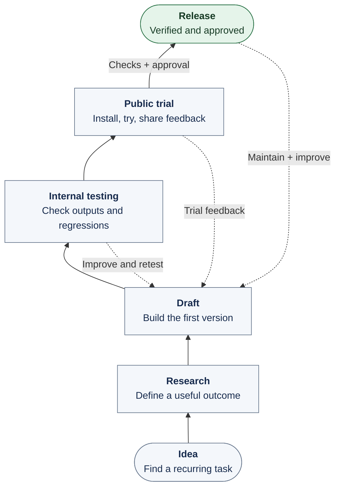

# Personal Agent Skills

**Good results shouldn't disappear with the chat.**

A diagram you can bring to a review. A technical draft that sounds like you. A useful next step when a conversation stalls. This collection turns those recurring needs into skills you can try with your own agent.

## What would you like to get done?

### Put your architecture on the page

Describe how your system works. **Architecture Diagram** helps turn it into an editable draw.io diagram: follow a request, see the boundaries, and bring something concrete to the discussion.

[See what it does and try the preview →](./incubator/architecture-diagram/candidate/architecture-diagram/README.md)

### Keep the technical meaning. Make the writing sound like you.

An email, a design document, a paragraph that feels too generic. **Tech Humanizer** helps rewrite it naturally while preserving the details that matter.

[Explore Tech Humanizer →](./incubator/tech-humanizer/README.md)

### Get an unproductive chat moving again

When the conversation keeps circling, **Meta Thinking** helps uncover the goal or assumption worth revisiting and choose the next useful action.

[Explore Meta Thinking →](./incubator/meta-thinking/README.md)

Architecture Diagram is open for candidate trials. The writing and thinking skills are still in internal testing. No stable release is available yet.

## A skill gets better by being used

Every skill starts with a recurring problem. Read the path from the bottom up: explore the need, build a first version, test it, and invite people to try it before release.

Solid links show progress toward release; dashed links bring feedback back into the next improvement. Before release come package and installation checks, the required audit, and owner approval. A published version stays fixed while its successor goes through testing.

Want to use the same approach for your own skills? Borrow the [lifecycle playbook and checklist](./knowledge/skill-lifecycle/README.md). It covers trials, release checks, upgrades and hotfixes without tying you to one publishing platform.

## Contribute

Try a skill and tell us what happened: your input, the first result and what you wished it had done differently. Each skill's page has a feedback link. For repository changes, start with [AGENTS.md](./AGENTS.md) and the [engineering setup](./docs/HARNESS.md).
