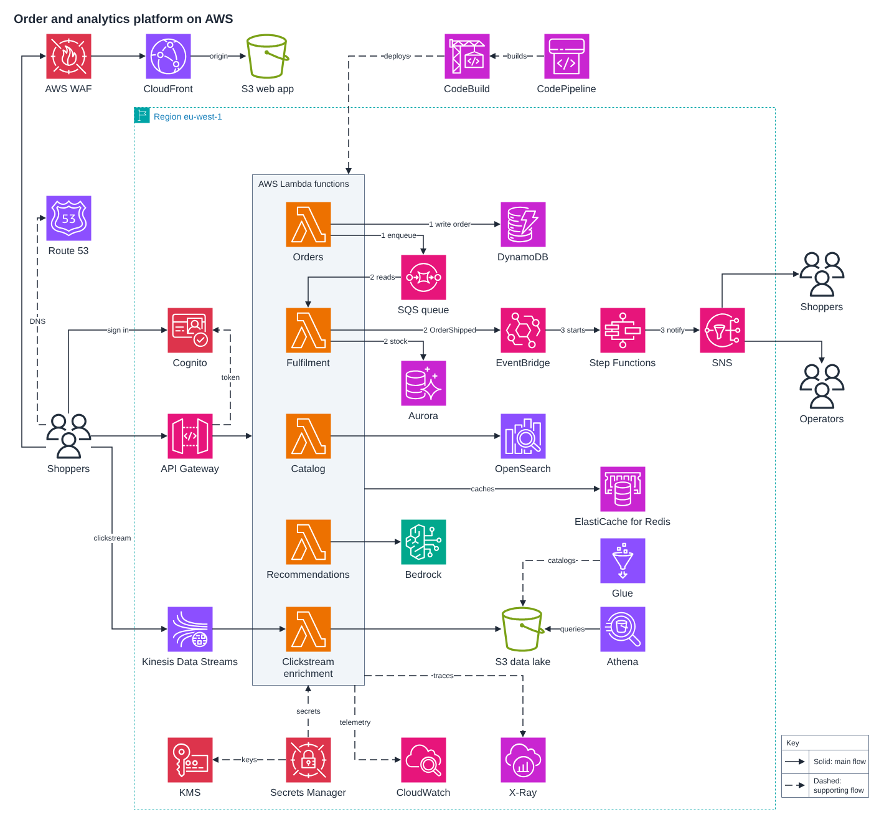
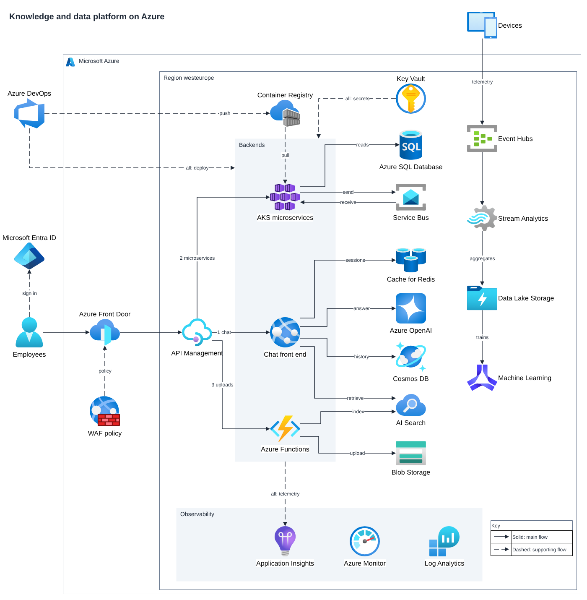

<div align="center">

# Skills for AI Agents

**Good results shouldn't disappear with the chat.**

Ready-to-install skills that teach your own AI agent to do one job well and hand you a result you can keep.

[](https://skills.sh/ClydeShen/skills)
[](https://agentskills.io)

</div>

---

## What is a skill?

A skill is a folder of instructions and scripts that your agent loads when a task calls for it. You install it once. From then on, you describe the job in plain words and the agent follows the skill.

## Released skills

### Architecture Diagram

Describe how your system works in plain text and get an editable architecture diagram.

<div align="center">

<a href="./skills/architecture-diagram/README.md"></a>

</div>

<table>
  <tr>
    <td width="50%" align="center">
      <a href="./skills/architecture-diagram/README.md"></a>
      <br><sub>A knowledge and data platform on Azure</sub>
    </td>
    <td width="50%" align="center">
      <a href="./skills/architecture-diagram/README.md"></a>
      <br><sub>Private access from Azure to AWS</sub>
    </td>
  </tr>
</table>

<sub>Every picture is the skill's unedited output for a text description.</sub>

Use it to:

- **Bring a diagram to a design review** that shows who talks to whom and where the boundaries are.
- **Paste a picture into a wiki or document** without redrawing it by hand.
- **Keep editing** the same diagram in draw.io as the system changes.

Install it in your project:

```sh
npx --yes skills@1.7.4 add ClydeShen/skills --skill architecture-diagram
```

[See the examples, what it checks and how to start →](./skills/architecture-diagram/README.md)

More skills are in testing. They appear here when they are released.

---

## About the releases

A skill is published only as an exact package that the owner has approved, and a published version is never edited in place. To build and check your own skills the same way, borrow the [lifecycle playbook and checklist](./knowledge/skill-lifecycle/README.md).

## Feedback

Try a skill and send what happened: your input, the first result and what you expected instead. Each skill's page has a feedback link.

<sub>Working on this repository? Start with [AGENTS.md](./AGENTS.md).</sub>
