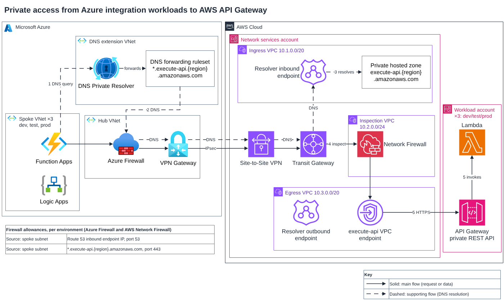
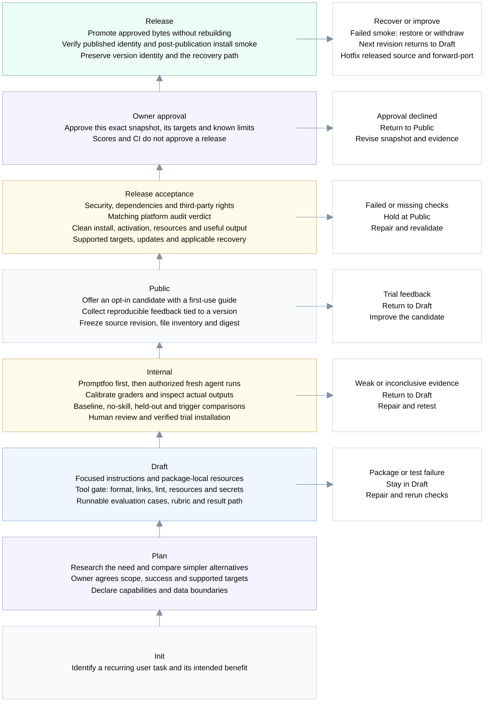

# Personal Agent Skills

**Good results shouldn't disappear with the chat.**

A diagram you can bring to a review. A technical draft that sounds like you. A useful next step when a conversation stalls. This collection turns those recurring needs into skills you can try with your own agent.

## What would you like to get done?

### Put your architecture on the page

Describe how your system works. **Architecture Diagram** helps turn it into an editable draw.io diagram: follow a request, see the boundaries, and bring something concrete to the discussion.

[](./skills/architecture-diagram/README.md)
[](./skills/architecture-diagram/README.md)
[](./skills/architecture-diagram/README.md)
[](./skills/architecture-diagram/README.md)



<sub>Drawn by the skill from a text description, unedited. [More examples and the input behind each.](./skills/architecture-diagram/README.md)</sub>

```sh
npx --yes skills@1.7.4 add ClydeShen/skills --skill architecture-diagram --agent codex --copy --yes
```

[See what it does and what to try first →](./skills/architecture-diagram/README.md)

### Keep the technical meaning. Make the writing sound like you.

An email, a design document, a paragraph that feels too generic. **Tech Humanizer** helps rewrite it naturally while preserving the details that matter.

[Explore Tech Humanizer →](./incubator/tech-humanizer/README.md)

### Get an unproductive chat moving again

When the conversation keeps circling, **Meta Thinking** helps uncover the goal or assumption worth revisiting and choose the next useful action.

[Explore Meta Thinking →](./incubator/meta-thinking/README.md)

Architecture Diagram is released; for Claude Code, replace `--agent codex` with `--agent claude-code`. The writing and thinking skills are still in internal testing and are not released.

## A skill gets better by being used

An installable skill is not necessarily a useful one, and a passing test is not permission to publish. Read from the bottom up: each gate asks for evidence before the next step.



**Tools check correctness. Agents produce evidence. The owner decides what ships.** Read upward for progress; the right-hand cards name return and recovery actions, not extra lifecycle stages. Missing required evidence blocks progress. Changed content reopens affected checks; an audit or approval for different bytes does not carry over.

These are required controls, not a claim that every gate is automated. Local checks and snapshot verification are implemented; real-client acceptance, rights review, platform audit and release approval still need recorded evidence. This project's publication profile requires skills.sh audit. Entering `internal` means evaluation is runnable; entering `public` means a candidate can be tried—not that it has passed release acceptance.

After release, improvements leave the published version intact. A hotfix starts from its recorded source, passes the same applicable gates and is forward-ported to ongoing work. Failed delivery restores the previous verified package or withdraws a failed first release; state recovery is separate where relevant. Only the owner changes an accepted baseline.

Want to use the same approach for your own skills? Borrow the [lifecycle playbook and checklist](./knowledge/skill-lifecycle/README.md). It covers trials, release checks, upgrades and hotfixes without tying you to one publishing platform.

## Contribute

Try a skill and tell us what happened: your input, the first result and what you wished it had done differently. Each skill's page has a feedback link. For repository changes, start with [AGENTS.md](./AGENTS.md) and the [engineering setup](./docs/HARNESS.md).
