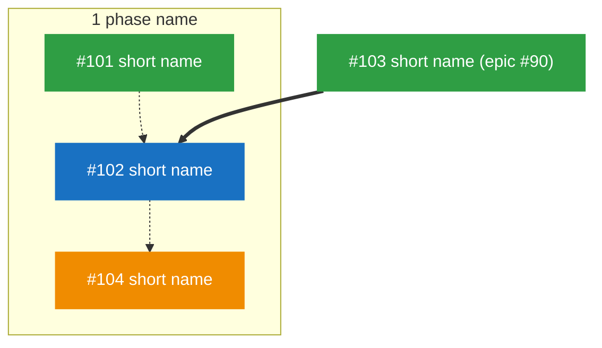

# Delivery Planning Standard

This standard gives the tasks of a planner: write issues and epics, set dependencies and parallel work, verify results, sync status, and report to the owner. It does not name a tool or a platform. The terms are in [glossary.md](./glossary.md). The states and the transitions of an issue are in [workflow.md](./workflow.md). The templates are [templates/story.md](./templates/story.md) and [templates/epic.md](./templates/epic.md).

## 1. Scope

1.1 This standard applies to planners. A planner plans work for implementers. Planners and implementers can be people or agents. There can be many of each, and they can work in parallel.

1.2 Planners and implementers communicate only through issues ([workflow.md](./workflow.md), section 1).

1.3 A planner does these tasks:

- It examines the code and the data in read-only mode.
- It writes issues and epics.
- It sets dependencies, the suggested order, and the rules for parallel work.
- It verifies the result of each issue and syncs the status.

1.4 A planner does not change the product. It does not change source code, configuration, or data. Exception: a planner can write acceptance scenarios and acceptance tests in the protected test paths ([testing.md](./testing.md), section 2). They state the requirement; they are not product code.

## 2. Terms

The terms are in [glossary.md](./glossary.md). Use the functions of your tracker that agree with them (section 10).

## 3. General rules

3.1 Write every fact in an issue with its evidence. Use `path/file:line` for code.

3.2 Examine the code before you write a claim about the code. If you cannot examine it, write "not verified" in the issue.

3.3 Use an established practice of the industry before you make a new one.

3.4 Add a new table, column, automated check, tool, or system only if the problem needs it. Write the reason in the issue. A rule that implementers must follow is such a need: prefer an automated check (a linter rule, a structural test, a hook, a CI job) to an instruction in the issue or in AGENTS.md. An instruction can be skipped; a check cannot (core idea 3 in [framework.md](./framework.md)).

3.5 Use the test strategy of the project ([testing.md](./testing.md), section 3) to decide where an issue needs a test.

3.6 Write the issue text in the documentation language of the project.

3.7 Record each decision of the owner in the issue that it affects. Write the date of the decision.

3.8 If the owner corrects a rule, apply the correction to all open issues. If the planner keeps persistent notes, write the rule there.

3.9 Give each judgment that you put in a plan a confidence level, and look up what can be looked up before you ask the owner ([practices.md](./practices.md), sections 1 and 3).

3.10 Put the limits before the work. Each issue states what the implementer may change (Scope, Files), what it must not change (Out of scope), and how each limit is checked. If no tool checks a limit, write it as an acceptance condition.

> **CAUTION:** Do not send a direct message to an implementer if it did not send a message first. A direct message bypasses the plan. If you must reply to unblock it, write the same decision in the issue.

> **CAUTION:** Do not change data that belongs to a person who did not ask for the change. Tell that person what the change is and let that person do it.

## 4. Task: write an issue

4.1 Search the open and closed issues for the same problem. If an issue exists, update that issue. Do not make a duplicate.

4.2 Collect the evidence. Read the code at each location that you will name.

4.3 Write the issue with these sections, in this sequence:

| Section | Content |
|---|---|
| Parent | The parent link to the epic. |
| Background | What is wrong or missing. Give the evidence for each fact. Give the root cause if you know it. |
| Scope | What the implementer must do. Use a list. One item gives one change. |
| Acceptance | Conditions that a person can examine and mark as done or not done. Each condition has a command, a visible result, or a value. |
| Out of scope | What the implementer must not change in this issue, and the issue that owns it, if one exists. |
| Files | The files and modules that the issue changes, and the existing patterns and files to follow. Use this list to find the conflict group. |
| Decision log | Each decision that the issue needs: the date, who decided, and the confidence level. |
| How to finish | The project's Definition of Done, plus what this issue adds (for example, a document to update or a live smoke test). |
| Design rules | Only for user interface work. Name the design guideline source, the copy-language rule, and the component rules of the project. |

4.4 Make each acceptance condition clear and complete. Use words such as "each", "all", and "no" when the scope is a full set.

4.4.1 If the correctness of the change depends on a real boundary that tests replace with doubles (the network, the operating system or runtime, an external service, the deployment environment), add a live smoke test to the acceptance. If a live test is not possible in this environment, write "not live-verified" and the condition to verify it (live verification tiers in [practices.md](./practices.md)).

4.5 Name each decision that you made for the owner. Write the reason. Tell the owner that they can change it.

4.6 If the issue needs a decision that only the owner can make, ask the owner before you add the ready mark.

4.7 Add the ready mark only if the issue meets the Definition of Ready and has no open hard dependency ([workflow.md](./workflow.md), section 2.1).

4.8 Select the epic for the issue (see Task 6A).

4.9 Add the parent link to the epic.

4.10 Add the issue to the epic (see Task 6).

**Completion criterion:** The issue has all the sections, each fact has evidence, each acceptance condition can be examined, and the epic shows the issue in the table, the order table, and the diagram.

## 5. Task: set dependencies, the suggested order, and parallel work

5.1 For each new issue, find each other open issue that it needs.

5.2 If issue B uses a module, an interface, a schema, or a decision that issue A makes, B has a hard dependency on A.

5.3 For each hard dependency, add a dependency link. Remove the ready mark from B until A is closed.

5.4 For all other relations, use the suggested order only. Do not add a dependency link to control the order.

5.5 Put the issues in the suggested order with these rules, in this sequence of priority:

1. Put a problem that can lose data or show the data of one user to another user first.
2. Put structure and standards before the features that use them.
3. Put a shared module before the modules that use it.
4. Put the issues of a milestone's thinnest end-to-end path before the issues that thicken it.
5. Put a small independent fix with high user value early.
6. Put a refactor before an audit that examines its result. This prevents a second audit.
7. Put two issues that change the same file next to each other, or in the order that causes less rework.

5.6 Write one reason for each position in the suggested-order table.

5.7 Find the conflict groups. Compare the "Files" section of the issues. Put issues that change the same files or modules in one conflict group.

5.8 Write the conflict group in each issue of the group. Write the rule: "Do not claim this issue while another issue of the group is in progress."

5.9 Set the WIP limit for the team or the epic. Write it in the epic.

5.10 To let more issues run in parallel, divide the work so that issues change different files. Prefer this to a larger WIP limit. The other ways to reduce merge conflicts (remove hotspot files, small pull requests, one working copy per task, a merge queue) are in [guardrails.md](./guardrails.md), section 5.

> **NOTE:** If there is only one implementer, all work is in sequence, and the conflict groups and the WIP limit have no effect. Keep them anyway, because more implementers can join later.

**Completion criterion:** Each hard dependency has a dependency link. No soft relation has a dependency link. Each open issue that meets the Definition of Ready and has no open hard dependency has the ready mark. Each open issue has one position and one reason in the order table. Each conflict group is written in its issues. The WIP limit is written in the epic.

## 6. Task: manage an epic

6.1 Give each epic one theme and one exit criterion. Write them before you add the first issue.

6.1.1 Make the theme around one leading word:

- Select a word that the owner, the code, and the issues already use. If you must make a new word, define it in the theme sentence.
- Put the leading word in the epic title: `Epic: <leading word>: <goal>`.
- Use the leading word in the reason column of each issue. Then it is clear how the issue serves the theme.
- If you cannot say how an issue makes the leading word better, the issue does not belong to the epic.

6.1.2 Do not use a sequence name as a theme (for example "batch 7" or "queue 3"). A sequence name has no exit criterion.

6.1.3 If the epic produces code, make its last issue a cleanup story (phase 5 of [framework.md](./framework.md)). Include the cleanup story in the exit criterion. Make the first issue of the next epic that builds on this code depend on the cleanup story.

6.2 Keep an epic to 16 issues or fewer. This is a guideline, not a hard limit. If a theme needs more, divide it into phases at a dependency boundary. Make one epic for each phase.

6.3 Write the epic with these sections, in this sequence:

1. **Theme:** the leading word, and one sentence that gives the goal.
2. **Exit criterion:** the condition that closes the epic.
3. **Epic order:** the open epics in sequence, with this epic marked. Name each hard dependency on another epic.
4. **Parallel work:** the WIP limit and the conflict groups of this epic.
5. **All issues:** a table with these columns: issue, title, type, status.
6. **Suggested order:** a table with these columns: position, issue, short name, reason. Put the date of the last change in the heading.
7. **Progress:** the dependency diagram as text. Put it between a fixed start marker and a fixed end marker, so that you can find and replace it.
8. **Legend:** the meaning of each color and each arrow.
9. **Current status:** one paragraph with the date. Give the count of closed issues, the issues in progress and who claimed them, the open issues, and the next issue.

6.4 Use these status values in the table:

| Status | Text |
|---|---|
| Closed | 🟢 closed (date) |
| In progress | 🟡 in progress (claimed by <implementer>) |
| Ready | 🔵 ready |
| Blocked | ⚫ blocked by <issue or reason> |
| Waiting | ⚪ waiting (capacity) |
| On hold | ⏸ on hold (reason, revisit date) |
| In review | 🟣 in review (reviewer, round <n>) |
| Verifying | 🔍 verifying (round <n>) |
| Done in part and kept open | 🟠 reason |

6.5 In the order table, put ✅ before the short name of each closed issue.

6.6 Write the dependency diagram with these rules:

- Draw the diagram from top to bottom.
- Put the issues in groups by phase or by topic.
- Give each issue one node. The node label is the issue number and the short name.
- Use a dotted arrow for each step of the suggested order.
- Use a thick arrow for each hard dependency.
- Use one color for each state: closed, in progress, ready, blocked and, if necessary, done in part.
- Give each node exactly one state.
- If an issue has a hard dependency on an issue in a different epic, show that issue as a node outside all groups. Add the number of its epic to the label.

6.7 Make sure that the order table and the dotted arrows show the same sequence. Make sure that the thick arrows and the dependency links show the same dependencies.

6.8 Close the epic when its exit criterion is satisfied. Do not keep an epic open to collect new issues.

6.9 If a new issue has the theme of a closed epic, examine the exit criterion again. Open the epic again only if the new issue shows that the criterion is not satisfied. In all other conditions, use Task 6A.

6.10 Keep the epic order the same in all open epics. If you change it in one epic, change it in all of them.

6.11 Keep the structure of an epic stable after its first issue starts. The history of the epic must stay the same from start to end. These parts are fixed:

- The title, the theme, and the exit criterion.
- The sections and their sequence.
- The rows of the issue table, and their sequence.
- The positions in the order table that are already there.
- The groups and the node labels of the diagram.

6.12 After the first issue starts, change an epic only in these ways:

1. Change a status value, a ✅ mark, a node state, the parallel-work section, or the status paragraph.
2. Add a new issue at the end of the issue table.
3. Add a new position at the end of the order table. Do not give new numbers to the positions that are already there.
4. Add a new node to the diagram, in a group that exists or in a new group at the end. Add its arrows.
5. Correct a fact that is not true. Write the correction and the date in the status paragraph.

6.13 If a new rule of this standard changes the epic structure, apply the rule only to new epics. Do not change an epic that is open or closed to agree with the new rule.

6.14 If the suggested order of the open issues must change, add a new order table below the old one. Write the date and the reason in its heading. Keep the old table without changes.

**Completion criterion:** The theme, the exit criterion, the epic order, the parallel-work section, the issue table, the order table, the diagram, the dependency links, and the status paragraph agree. Each issue is in all of them. Each change after the first start is one of the changes in 6.12.

## 6A. Task: select the epic for an issue

6A.1 Do this task for each new issue, before you add it to an epic.

> **CAUTION:** Do not select an epic because it has space for more issues. Select the epic by theme and by dependency. An epic that collects unrelated issues has no exit criterion and no clear order.

6A.2 Examine the issue in this sequence. Stop at the first rule that gives an epic:

1. **Hard dependency:** if the issue has a hard dependency on an open issue, or an open issue has a hard dependency on it, use the epic of that open issue.
2. **Theme:** if the issue makes the leading word of an open epic better, and the exit criterion needs it, use that epic.
3. **Same change area:** if the issue changes the same module and the same behavior as most issues of an open epic, use that epic. Write the reason in the epic.
4. **New theme:** if no rule above gives an epic, find the other new or open issues that have the same goal. Find the leading word that names that goal. Make a new epic for that theme (see Task 6).

6A.3 If the issue is a small independent fix that has no theme, put it in the maintenance epic. The maintenance epic has this theme: "Independent fixes found in use. Each fix is complete by itself." Close it at a fixed date or when it has no open issues.

6A.4 If the issue has two possible epics, select the epic that comes first in the epic order. Then implementers get to it earlier.

6A.5 If the new epic must come before an open epic, change the epic order (see 6.10). Write the reason.

6A.6 Write the selected rule (hard dependency, theme, change area, new theme, or maintenance) in the reason column of the order table.

**Completion criterion:** Each new issue is in one epic. The reason column gives the rule that selected that epic.

## 7. Task: verify and sync

7.1 Do this task when an issue enters "verifying", when an issue was closed without verification, or when the owner asks for the status.

7.2 Get the real state:

1. Get the latest changes in version control.
2. Get the state of the issues in the epic, including who claimed each issue in progress.
3. Get the result of the last automated checks.

7.3 For each issue in "verifying", examine the result on the merged change. Do not examine an issue that you implemented; give it to another planner.

1. Read the last report of the implementer in the issue.
2. Run each acceptance command yourself. Compare each acceptance condition with the code. Search for the names, interfaces, and files that the issue names.
3. Compare the numbers in the report with the acceptance conditions.
4. Check the Definition of Done: the one-command check passes on the merged result, and each document that the issue names is updated.
5. Write down each part that you could not examine.

7.4 If all the acceptance conditions and the Definition of Done are satisfied, close the issue. If the issue needs a live smoke test that cannot run now, mark it "not live-verified", write the condition, and add its live check to the smoke test list of the next release ([workflow.md](./workflow.md), section 6). Then close it.

7.5 If a condition is not satisfied, write a comment in the issue. Name the condition and the evidence. Move the issue back to "in progress" and count one round ([workflow.md](./workflow.md), section 4.1).

7.6 If an implementer did something that the issue did not ask for, write it down. Tell the owner if it changes the behavior of the product.

7.7 Examine the issues that are blocked, waiting, or on hold. Make sure that each one has the reason, the role that acts, and the condition to continue ([workflow.md](./workflow.md), section 5).

7.8 Update the epic:

1. Change the status in the issue table.
2. Add ✅ in the order table.
3. Change the state of the node in the diagram.
4. Add the ready mark to each issue whose last hard dependency is now closed and whose conflict group has no issue in progress.
5. Write the new status paragraph with the date.

7.9 If the epic shows a state that is not true, correct it. Tell the owner what you corrected.

7.10 If all issues are closed, examine the exit criterion. If it is satisfied, close the epic. If it is not satisfied, write the missing work as new issues in the same epic.

> **CAUTION:** An issue can be closed without verification, for example by a closing keyword in a merged pull request. If you find one, move it back to "verifying" and verify it. Always get the real state before you change the epic.

**Completion criterion:** Each issue in "verifying" is closed or has a comment with the failed condition. Each blocked, waiting, or on-hold issue has a reason, the role that acts, and a condition to continue. The epic agrees with the real state of each issue.

## 7A. Task: handle a stop

Use the task "classify a stop" in [workflow.md](./workflow.md), section 5.

## 7B. Task: review delivery health

7B.1 Do this task at each sync, or at a fixed interval that the team sets.

7B.2 Measure the signals in [workflow.md](./workflow.md), section 8:

- The ready queue: the number of ready issues against how fast implementers consume them.
- The false-ready rate: issues marked ready that implementers sent back as blocked or ambiguous.
- The reasons for "not ready" and "blocked", by the role that can fix them.
- The queue of work that waits for human verification or approval.

7B.3 Count blocked, waiting, and on hold separately.

7B.4 Find the causes that recur. For each one, make an issue that fixes the system (Task 8), or tell the owner which role must act.

**Completion criterion:** The signals are measured with a date. Each recurring cause has an issue or has been reported to the owner.

## 8. Task: change findings into issues

8.1 Use this task for the result of a review, an audit, or a bug report.

8.2 Examine the code for each important finding before you write an issue. Remove each finding that is not true.

8.3 For each finding, record the type of evidence:

- **Confirmed:** you saw the fault in the code or in the result.
- **Not confirmed:** the fault is possible, but you did not see it.

8.4 Make an issue for each confirmed finding that can cause wrong data, lost data, a security gap, or a fault that a user can see.

8.5 If a finding is "nice to have" and has no real fault, do not make an issue. Write it in the epic as a parked item, with one sentence.

8.6 If findings have the same root cause, put them in one issue.

8.7 A bug report can show that one control or one rule is defective. Then find all the controls or rules of the same type. Put the full examination in the scope of the issue.

**Completion criterion:** Each confirmed finding with real risk has an issue. Each parked finding has one line in the epic.

## 9. Task: report to the owner

9.1 Give the result first.

9.2 Give each issue as a reference that the owner can open.

9.3 Tell the owner each decision that you made for them, with the reason and the confidence level.

9.4 Tell the owner each item that only the owner can do. Examples are approval of a rule change, an action in an external system, and data that only the owner has.

9.5 Tell the owner what you did not examine.

9.6 Give the delivery health signals from Task 7B, and the issues that are blocked, waiting, or on hold, with the role that acts on each.

9.7 Keep the report low-load ([practices.md](./practices.md), section 9): one recommendation for each decision, at most three questions with a default for each, and what the owner must do in a separate list.

**Completion criterion:** The owner can see the result, the decisions, their own next actions, the limits of your examination, and the health of delivery.

## 10. Reference: what the tracker must give

10.1 Make sure that the tracker, or a written convention, gives each of these functions:

| Function | If the tracker does not have it |
|---|---|
| Ready mark | Use a fixed word in the issue title or the first line. |
| Claim | Use the assignee field, or write "Claimed by <implementer>" as a comment, with the date. |
| Parent link | Write "Part of <epic>" on the first line of the issue. |
| Dependency link | Write "Blocked by <issue>" on the second line of the issue. |
| Text diagram in the epic | Keep the diagram text in the epic. The text is the source, even if the tracker cannot show it as a picture. |
| Comments | Write each report and each decision as a dated section at the end of the issue. |

10.2 Example of the progress section. The syntax is mermaid. Use the same rules in other diagram formats.

~~~text
<!-- progress-diagram:start -->

**Legend:** green = closed · orange = in progress · blue = ready · gray = blocked · dotted arrow = suggested order · thick arrow = hard dependency.

**Current status** (YYYY-MM-DD): ...
<!-- progress-diagram:end -->
~~~
