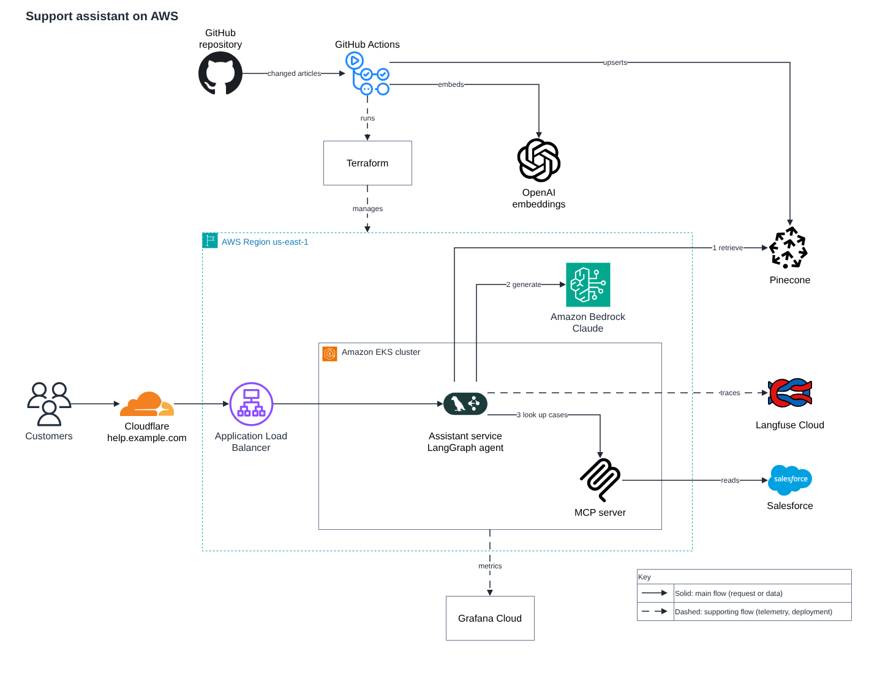
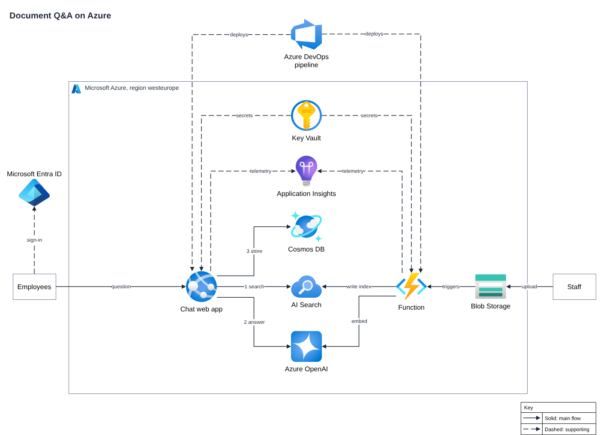
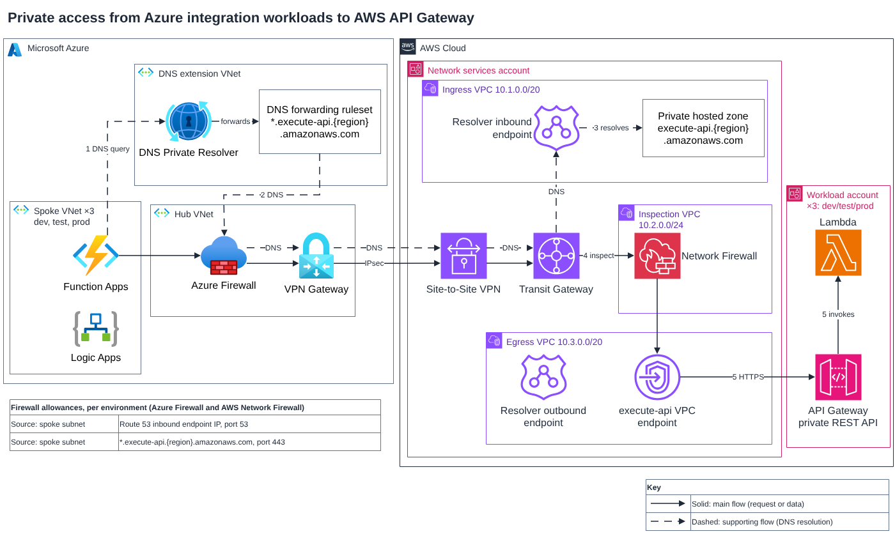

<div align="center">

# Architecture Diagram

**Describe your system in plain text. Get an editable architecture diagram.**

[](./LICENSE)
[](https://nodejs.org/)
[](https://www.drawio.com/)
[](#install)
[](#what-you-get)
[](#why-use-it)
[](https://www.skills.sh/clydeshen/skills/architecture-diagram)




<sub>Drawn by this skill from the short description under [See it work](#see-it-work). Unedited output of a clean agent session.</sub>

[Install](#install) · [See it work](#see-it-work) · [Examples](#examples) · [What it checks](#what-it-checks) · [FAQ](#faq)

</div>

---

## Why use it

You know how the system works. Everyone else has to picture it. This skill turns a description of requests, services and boundaries into a diagram you can bring to a design review, paste into a wiki or keep editing.

| Benefit                          | In practice                                                                                                                                                                                                                                                 |
| -------------------------------- | ----------------------------------------------------------------------------------------------------------------------------------------------------------------------------------------------------------------------------------------------------------- |
| **Layout that carries meaning**  | Boundaries show real membership. An arrowhead points where a request or data moves. Solid lines carry the main flow; dashed lines carry deployment, telemetry, secrets and DNS. One page by default, and a repeated structure is drawn once with its count. |
| **Real icons, never lookalikes** | More than 1,700 official AWS, Azure, Google Cloud and Kubernetes icons from the draw.io libraries, plus 75 bundled marks for platforms and AI services such as Cloudflare, GitHub, OpenAI, Pinecone and Langfuse. No exact icon? A plain labelled box.      |
| **Editable, not just a picture** | A `.drawio` file to open and change in draw.io, plus a PNG and an SVG of every page for documents and wikis.                                                                                                                                                |
| **It questions your source**     | A technical contradiction in your text is raised with a recommendation instead of being drawn as fact. Assumptions and open questions go into a short companion account, not onto the canvas.                                                               |
| **It checks its own work**       | Scripts report overlapping text, crossings, shared segments, detours and missing keys. The agent must read every rendered PNG before it hands the result over.                                                                                              |

## See it work

**You write** (the whole description behind the picture above):

> Customers open the support site at `help.example.com`. Cloudflare proxies the site and forwards requests to an Application Load Balancer in AWS region `us-east-1`.
>
> The load balancer sends requests to an assistant service that runs on an Amazon EKS cluster. The assistant is a LangGraph agent. For each question it:
>
> 1. retrieves related help articles from a Pinecone index;
> 2. calls Anthropic Claude through Amazon Bedrock to write the answer;
> 3. looks up the customer's open cases through an MCP server that also runs on the EKS cluster and reads from Salesforce.
>
> Every agent run is traced to Langfuse Cloud. The EKS cluster's metrics go to Grafana Cloud.
>
> Help articles are maintained in a GitHub repository. A GitHub Actions workflow embeds changed articles with OpenAI's embeddings API and writes them to the Pinecone index. Terraform, run from the same workflow, manages the AWS resources.

**You get** four files: `diagram.drawio`, `diagram.png`, `diagram.svg` and `agent-report.md`. The report is where the skill says what it assumed, for example:

> - Amazon Bedrock is drawn inside the us-east-1 Region (regional service, same Region as its caller). The source does not name its Region.
> - Terraform and Grafana Cloud have no catalog icon, so they are plain labelled boxes (Grafana lookup only offers Prometheus).
> - Several third-party SaaS dependencies (Pinecone, Salesforce, Langfuse, Grafana) are outside AWS; their connectivity (public internet vs private link) is not stated.

Open [the example folder](https://github.com/ClydeShen/skills/tree/main/incubator/architecture-diagram/examples/aws-support-assistant) to see the input, the editable file and the full report.

## Examples

Both examples are unedited output of clean agent sessions: only this package and the scenario, nothing else. Each folder holds the scenario, `diagram.drawio`, PNG, SVG and the companion account.

### Document Q&A on Azure

A chat app, a search index, a model, a database, a function that indexes uploads, secrets, telemetry and a deployment pipeline.



- The Microsoft Azure boundary carries the Azure mark, and the single region is named in its title.
- Steps the source numbers (search, answer, store) are numbered on their connectors.
- Dashed lines separate deployment, secrets and telemetry from the request path.

[Input, editable file and report](https://github.com/ClydeShen/skills/tree/main/incubator/architecture-diagram/examples/azure-document-qa)

### Private access from Azure to AWS

Function Apps in three Azure environments reach private API Gateways in AWS through a VPN, a Transit Gateway, DNS forwarding and a firewall inspection VPC.



- The DNS path (dashed) and the API path (solid) run side by side without sharing a line.
- The three Azure environments and the three AWS workload accounts are drawn once, with a count.
- The skill did not draw a statement that it judged technically doubtful. From its report:

> Step 5 says the Route 53 Resolver outbound endpoint forwards the request to the API Gateway VPC endpoint. An outbound endpoint forwards DNS queries to other resolvers. It does not carry API HTTPS traffic. I drew the outbound endpoint in the egress VPC with no connector, and the API path goes from the Network Firewall to the VPC endpoint. Please confirm what the outbound endpoint is for.

[Input, editable file and report](https://github.com/ClydeShen/skills/tree/main/incubator/architecture-diagram/examples/cross-cloud-private-api)

## What you get

| File              | What it is                                                                                              |
| ----------------- | ------------------------------------------------------------------------------------------------------- |
| `diagram.drawio`  | The editable diagram, one page per view. Open it in draw.io and change anything.                        |
| `diagram.png`     | A PNG of each page, sized for a wiki or a document.                                                     |
| `diagram.svg`     | A vector copy of each page.                                                                             |
| `agent-report.md` | The companion account: scope, assumptions, doubts about the source, design risks and the checks it ran. |

The PNG is rendered with draw.io's own viewer, so it matches the file.

## What it checks

The package ships its own scripts, so the agent can verify a diagram without a model or a network call:

- **Layout:** text that overlaps, connectors that cross or share a segment, detours around text, boundaries that a line leaves and re-enters, and pages wider than a reader can use.
- **Notation:** one kind of arrowhead, two kinds of line, a key whenever there is more than one kind, and no symbols that imitate connectors.
- **Steps:** every step your source numbers appears on a connector, in the order the drawn architecture runs.
- **Icons:** each icon is the exact upstream artwork, verified by hash, at one standard size.
- **Colour:** a contrast calculator for palette choices. Meaning never depends on colour alone.

Checks catch what can mislead a reader; they do not prove the architecture is right. The agent still has to read the picture, and so should you.

## Install

Use Claude Code or Codex with file access and Node.js 24. Install the skill in your project:

<details open>
<summary><strong>Codex</strong></summary>

```sh
npx --yes skills@1.7.4 add ClydeShen/skills --skill architecture-diagram --agent codex --copy --yes
```

</details>

<details>
<summary><strong>Claude Code</strong></summary>

```sh
npx --yes skills@1.7.4 add ClydeShen/skills --skill architecture-diagram --agent claude-code --copy --yes
```

</details>

The command copies the package into the project without automatic updates; run it again to update. Start a fresh client session afterwards and confirm that `architecture-diagram` appears in the skill list. PNG export uses draw.io Desktop, or Git and Chromium or Chrome with network access on first use. Without those you still get the editable file and a browser link for viewing and export.

## Try it

```text
Use the architecture-diagram skill to create diagram.drawio from this scenario:

A browser calls an API in AWS. The API publishes jobs to a queue.
A worker consumes jobs and stores results in a database in the same VPC.
Show the request path and background processing separately. Do not invent subnets.
```

Read the first diagram against your source: what is connected, which way each path goes and what sits inside each boundary. Then ask for corrections or edit the file yourself.

## How to read the result

| You see                             | It means                                                                                     |
| ----------------------------------- | -------------------------------------------------------------------------------------------- |
| A solid line                        | The main flow: a request or data moving between components.                                  |
| A dashed line with a one-word label | A supporting flow: deployment, management, telemetry, secrets, DNS or replication.           |
| An arrowhead                        | Where the request or data moves. A read from a queue or a secret store points to its reader. |
| A boundary with a provider mark     | A cloud, account, region or network the elements really belong to.                           |
| `×3` or "same stack" in a title     | A structure that repeats identically, drawn once.                                            |
| Numbers on connectors               | The order of execution, where your source states an order or the order matters.              |
| A plain labelled box                | A service with no exact icon available. The skill never borrows a similar one.               |

## FAQ

<details>
<summary><strong>Can I edit the result?</strong></summary>

Yes. `diagram.drawio` is a normal draw.io file. Boundaries are containers and icons are real shapes, so moving an element keeps its connectors attached.

</details>

<details>
<summary><strong>What if my architecture is not on AWS, Azure or Google Cloud?</strong></summary>

Kubernetes, many platforms and AI services have icons too (for example Cloudflare, GitHub, Argo CD, Kafka, OpenAI, Anthropic and Pinecone). Anything without an exact icon becomes a plain labelled box with its true name.

</details>

<details>
<summary><strong>Does it send my description anywhere?</strong></summary>

The package scripts do not send your scenario anywhere. The first render downloads the pinned draw.io viewer from GitHub, and the agent you run is whatever you chose. Use sanitized scenarios, as you would with any agent.

</details>

<details>
<summary><strong>What is it not for?</strong></summary>

It does not generate infrastructure code, reverse-engineer a codebase, trace an image or draw general flowcharts. It draws architecture from a text description.

</details>

<details>
<summary><strong>Is it safe to run?</strong></summary>

The scripts start local programs: Git to fetch the pinned draw.io viewer once, and Chromium to render. Rendering runs headless with its sandbox disabled, serves only a local page and resolves no name other than `127.0.0.1`. Read the scripts before you install, as you would for any skill.

</details>

## Good to know

- **Check the picture.** A static check is not proof of architectural correctness. Inspect the first diagram against your source.
- **Codex rendering.** A Codex sandbox may be unable to render a PNG. You then receive the `.drawio` file and a link for viewing and export.
- **License.** Original instructions and scripts use the [MIT license](./LICENSE). Third-party artwork retains its own terms in the [asset catalog](./assets/vendor-icons.json); this is not blanket MIT licensing of icons. Redistribution clearance and output attribution for some bundled artwork are not complete; the [third-party notices](./THIRD-PARTY-NOTICES.md) list what is cleared and what remains open.

Something drawn wrongly, or a scenario it struggles with? Share the input, the first diagram, the client and model, the installed revision and what you expected in [the feedback issue](https://github.com/ClydeShen/skills/issues/7).
