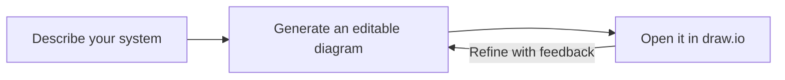

# Architecture Diagram

**You know the system. Help everyone else see it.**

A browser, an API, a queue, a worker. The pieces are familiar; the discussion gets harder when people have to picture every connection in their heads.

Give your agent the description and start with an **editable draw.io diagram** you can question, refine and share.

- **For a design review:** put the request path and system boundaries on the page, so people can point to the part they mean.
- **For a document or wiki:** export a PNG when rendering is available, while keeping the editable original.
- **When the design changes:** revise the diagram with feedback or open it in draw.io and make the change yourself.

[Try it with a flow you already know →](#try-the-preview)

## From a description to a discussion



Try a prompt like this:

```text
Use the architecture-diagram skill to draw this flow:

A browser calls an API in AWS. The API sends jobs to a queue.
A worker reads the queue and stores results in a database.
Show the request path and background processing separately.

Create diagram.drawio and a short agent-report.md for unresolved details.
```

You get the editable diagram, a PNG per page when local export is available, and a short account of assumptions or open questions. If a consequential detail is missing, the skill asks before committing it to the picture.

## Try the preview

Use **Codex or Claude Code**, file access and **Node.js 24**. It runs local programs; [review the scripts](./scripts/) before installing. Install in a disposable project, then start a fresh client session:

```bash
INSTALL_INTERNAL_SKILLS=1 npx --yes skills@1.7.4 add https://github.com/ClydeShen/skills/tree/main/incubator/architecture-diagram/candidate/architecture-diagram --agent codex --copy --yes
```

For Claude Code, replace `--agent codex` with `--agent claude-code`.

<details>
<summary>Windows PowerShell</summary>

```powershell
$env:INSTALL_INTERNAL_SKILLS = "1"
npx.cmd --yes skills@1.7.4 add https://github.com/ClydeShen/skills/tree/main/incubator/architecture-diagram/candidate/architecture-diagram --agent codex --copy --yes
```

</details>

This is a candidate preview, not a stable release. To pin a trial, replace `/tree/main/` with `/tree/<full-commit-SHA>/` in the URL.

## Before you share the result

Check the first diagram against your source: what is connected, which way each path goes, and what sits inside each boundary. The skill supports the discussion; the drawing still needs your review.

Scope: architecture from text, including request, event, authentication and cross-cloud flows. Infrastructure-code generation, code reverse engineering and image tracing are not included.

<details>
<summary>Rendering, safety and licensing</summary>

PNG export uses draw.io Desktop, or Git plus Chromium/Chrome with network access on first use. Without those, the skill provides the editable file and a browser link for viewing/export. It targets draw.io 32.6.1.

The runtime scripts start local programs and may clone a pinned draw.io viewer. Review them before installing, and use sanitized scenarios. A static check is not proof of architectural correctness.

Original instructions and scripts use [MIT](./LICENSE). Artwork retains its own terms; see [third-party notices](./THIRD-PARTY-NOTICES.md). Remaining artwork clearance and output attribution are still being checked before stable publication.

</details>

Have a scenario it struggles with? Share the input, first diagram, client/model, installed revision and what you expected in [the feedback issue](https://github.com/ClydeShen/skills/issues/7).
