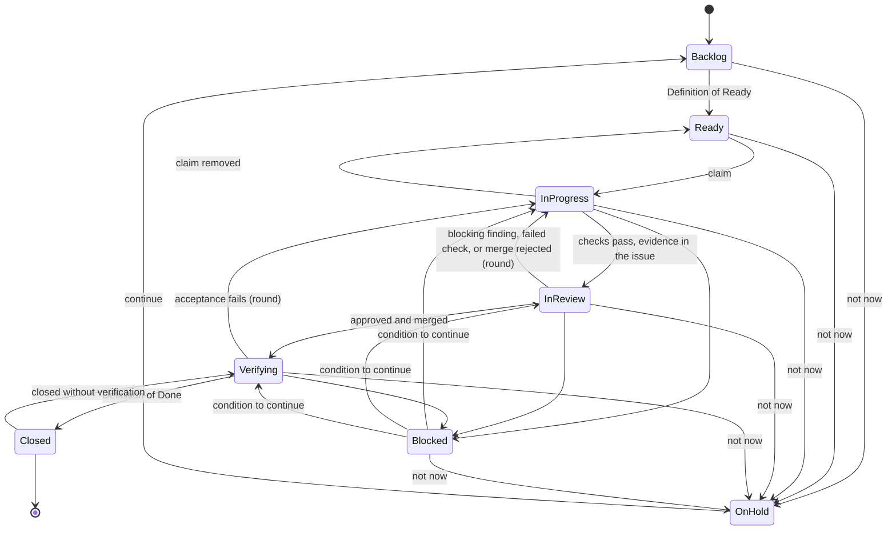

# Workflow

This standard gives the states of an issue, the transitions between them, and the loops that close the work, from "ready" to production and back. It applies to all roles: planners, implementers, reviewers, and the owner. The roles and the terms are in the repository [GLOSSARY.md](../../GLOSSARY.md). The tasks of each role are in [planner-standard.md](./planner-standard.md) (planner), [reviewer-standard.md](./reviewer-standard.md) (reviewer), and [templates/implementer-agents-md-template.md](./templates/implementer-agents-md-template.md) (implementing agent).

## 1. Rules for all roles

1.1 The tracker is the single source of truth for the state of the work. Communicate through the issues. Write each decision in the issue that it affects.

1.2 Move an issue only along a transition in section 3, and only when its condition is satisfied. Write the evidence in the issue.

1.3 Use the tracker or the hosting platform to enforce a condition where it can (required checks, branch rules, a merge queue, workflow rules). If it cannot, the state owner of the next state checks the condition.

## 2. States

| State | Meaning | State owner |
|---|---|---|
| Backlog | The issue exists. It does not meet the Definition of Ready, or it has an open hard dependency. | Planner |
| Ready | The issue meets the Definition of Ready and has no open hard dependency. | Implementer (who claims it) |
| In progress | One implementer claimed the issue and works on it. | Implementer |
| In review | The implementer reported the change as done. A reviewer examines it until it is merged. | Reviewer |
| Verifying | The change is merged. A planner checks the acceptance on the merged result. | Planner |
| Closed | The acceptance and the Definition of Done are verified. | — |
| Blocked | The work cannot move forward, also if someone with capacity picks it up now. | The role that can remove the cause |
| On hold | The business decided "not now". The issue is outside the flow until the owner continues it. | Owner |

"Waiting" is not a state. It is a ready issue that nobody can claim now, because no person, agent, or resource is free. It shows a capacity problem, not a block.

2.1 **Definition of Ready**: an implementer (person or agent) can act on the issue at "high" confidence without asking ([judgment-practices.md](./judgment-practices.md), section 1). The issue has all of these:

- A clear Definition of Done.
- No open hard dependency.
- Acceptance conditions that can be tested: each has a command, a visible result, or a value.
- The acceptance examples that need a new test are committed in the protected paths ([testing-standard.md](./testing-standard.md), section 2):
  - If an example runs without new connecting code, it fails because the behaviour is missing.
  - If an example needs new connecting code, it is marked pending. The implementer writes the connecting code first and shows that the example then fails because the behaviour is missing.
- The decisions that it needs, in the decision log.
- The existing patterns and files to follow.

Hold agents to a stricter bar than people. A person asks about a vague issue. An agent guesses.

2.2 **Definition of Done**:

- A planner who is not the implementer ran each acceptance command on the merged result. A self-report is not evidence.
- The one-command check passes on the merged result.
- The documents that the issue names are updated.
- If the issue needs a live smoke test: the test ran and passed, or the issue is marked "not live-verified" and its live check is on the smoke test list of the next release (section 6).

2.3 **Definition of Blocked**: one of these is true:

- A hard dependency is open.
- A decision is missing that only the owner (or the person that the owner named for the area) can make.
- The requirement is undecided or changes.
- An environment or an external system is not available.
- An acceptance condition cannot be verified.
- The round limit is reached.
- A conflict between sources of feedback cannot be settled by the order of sources ([feedback-loops-standard.md](./feedback-loops-standard.md), section 3).

When an issue is blocked, stop. Write the reason, the role that can remove the cause, and the condition to continue. Do not guess your way around the block.

## 3. Transitions

| From | To | Who moves it | Condition |
|---|---|---|---|
| Backlog | Ready | Planner | The issue meets the Definition of Ready and has no open hard dependency. |
| Ready | In progress | Implementer | The implementer claims it. No issue of its conflict group is in progress. The WIP limit is not reached. |
| In progress | Ready | Implementer | The implementer removes its claim. The issue says what is done and the next step. |
| In progress | In review | Implementer | The one-command check passes. The report in the issue has the command and the output of each acceptance condition. The change is ready to merge (for example, a pull request). |
| In review | In progress | Reviewer | A required check fails, the merge queue rejects the change, or there is a confirmed blocking finding. Count one round. |
| In review | Verifying | Reviewer approves; the implementer or the merge queue merges | No confirmed blocking finding. The full check passes at the last gate ([guardrails-standard.md](./guardrails-standard.md), section 1). The change is merged. |
| Verifying | In progress | Planner | An acceptance condition or the Definition of Done is not satisfied on the merged result. Count one round. |
| Verifying | Closed | Planner | The Definition of Done is satisfied (section 2.2). |
| Closed | Verifying | Planner | The issue was closed without verification (for example, by a closing keyword in a merged pull request). |
| In progress, In review, Verifying | Blocked | The state owner | The Definition of Blocked is satisfied. |
| Blocked | The state before the block | The role that can remove the cause | The condition to continue is satisfied. |
| Backlog, Ready, In progress, In review, Verifying, Blocked | On hold | Owner | The business decided "not now". Remove the claim and the ready mark. Write the reason and the date to revisit. |
| On hold | Backlog | Owner | The owner continues the issue, at the latest on the revisit date. |

The table is the source. The diagram shows the table.

## 4. Rules for the transitions

4.1 **Round limit.** Set a round limit for the project, for example 3. Count one round for each move back to "in progress" from "in review" or "verifying", and for each revert after a merge. At the limit, mark the issue blocked. Write the rounds and the open findings. The owner decides.

4.2 **A failing main branch.** If a merged change makes the main branch fail, revert the change first. Then move the issue back to "in progress" and count one round. Do not fix forward while the main branch fails. Exception: a project with `throughput: tolerant` can fix forward when the fix is ready within a time limit that the project writes down (for example, 30 minutes); after the limit, revert. Write each fix forward in the issue.

4.3 **Closing keywords.** Do not use the keywords that close an issue on merge (for example, `Fixes #12` on some hosting platforms). Refer to the issue with a trailer such as `Refs: #12`. A closing keyword moves the issue to "closed" without verification.

4.4 **A change of claim.** To take over an issue that another implementer claimed, ask in the issue. Change the claim only when the first implementer removes it, or by the rule that the team set for claims with no answer ([human-team-in-loop.md](./human-team-in-loop.md), B4 and B5). The state does not change.

4.5 **New states.** A project can add states. Each new state must have a state owner, a condition to enter, and a transition out. Check the workflow with the closure rules in section 7.

## 5. Task: classify a stop

5.1 Do this task when work on an issue stops, or when an implementer reports that it cannot continue. The state owner does it. A planner confirms it at the next sync.

5.2 Ask these questions in sequence. Stop at the first "no":

| # | Question | If "no" | Who acts | What to do |
|---|---|---|---|---|
| 1 | Does the business still want this now? | On hold | Owner | Move the issue to "on hold". Write the reason and the date to revisit. |
| 2 | Can the work move forward if someone with capacity picks it up now? | Blocked | The role that can remove the cause | Mark it blocked. Write the reason, the role that can remove the cause, and the condition to continue. |
| 3 | Is someone, or some resource, available to pick it up now? | Waiting | The role that allocates capacity | Leave it in "ready". |

5.3 If the requirement is undecided or changes, the issue is blocked: a decision is missing. If the requirement is decided but deferred, the issue is on hold.

5.4 If the gap existed before the work started, the issue was not ready. Count it as a false ready, and write the cause.

5.5 Do not stop the clock while an issue is blocked. Whether the cycle time of an on-hold issue starts again when it comes back is a project choice; write it down.

**Completion criterion:** The issue has one state, a reason, the role that acts, and a condition to continue. Each false ready is counted with its cause.

## 6. Release

A closed issue is not in front of users. The release loop puts it there and checks it.

6.1 **Trigger.** Write what starts a release: for example, a version tag, a merge to a release branch, or a schedule. For a library, a release is a published package.

6.2 **What goes into a release.** Release only from a commit where each included issue is closed, or its change is behind a switch (a feature flag) that is off. If verification fails and the fix will not be ready before the next release, revert the change or switch it off.

6.3 **Smoke test after release.** Run a short test of the released system or package, in minutes, that touches each main part once. Examples: sign-in, the database, the main call of the API; for a library, install the published package in a clean project and run one example. Add the live checks of the issues that are marked "not live-verified" (section 2.2). Do not use real user data.

6.4 **Result.** Write the result of the smoke test in the release record, with each live check. A release that passes is live-done for its issues. If the smoke test fails, stop the release. Do not continue because the test "is probably flaky". Treat a failed live check of an issue as an incident.

6.5 **Rollback.** Write how to undo a release: switch a flag off, or deploy the previous version. A flag does not undo a database migration or a change of a data format. Give such a change its own plan, for example a format that the previous version can still read.

6.6 **Watch.** For a fixed time after the release, the release role reads the logs and the errors.

6.7 **Incidents.** After an incident, write a postmortem: the impact, what was done, the root cause, and the actions that prevent a repeat. Make each action an issue with an assignee, a result that can be checked, and a date. "Improve monitoring" is too vague; "alert when the error rate is above 2% for 5 minutes" is clear. Write the lesson in the feedback log ([feedback-loops-standard.md](./feedback-loops-standard.md), section 4.4).

## 7. Loop cards and closure rules

7.1 The work moves through several loops. Describe each loop with one loop card:

| Field | Content |
|---|---|
| Trigger | The event or the time that starts the loop. |
| Who acts | The role. |
| Verifier and evidence | Who decides that it worked, and with which evidence from outside the loop (a command, a test, monitoring). |
| Done when | The result that ends the loop. Output that nobody uses does not count. |
| Limit | The maximum number of rounds, the time, or the budget. |
| Escalation | Who gets the work at the limit, or when a decision is missing. |
| Record | Where the result and the lesson are written. |

7.2 The loops of this playbook:

| Loop | Trigger | Who acts | Verifier and evidence | Done when | Limit | Escalation | Record |
|---|---|---|---|---|---|---|---|
| Agent session | Each edit; the end of each turn | Implementer | Session hooks: lint, types, related tests | The checks pass | Attempts for the same failure (AGENTS.md) | Blocked; the owner | The issue |
| Review | The issue enters "in review" | Reviewer, then implementer | Required checks; confirmed findings ([reviewer-standard.md](./reviewer-standard.md)) | Approved and merged | Round limit | Blocked; the owner | The issue |
| Verification | The issue enters "verifying" | Planner | The acceptance commands, run on the merged result | Closed | Round limit | Blocked; the owner | The issue; the epic |
| Release | The release trigger | Release role | Smoke test after release, with the live checks; logs and errors during the watch time | Released, and the smoke test passed | One rollback, then stop | The owner | The release record |
| Incident | An alert or a user report | On-call role | Monitoring shows that the service is restored | Restored; each postmortem action is an issue | The dates of the actions | The owner | The postmortem; the feedback log |
| Harness | The end of a milestone; a problem seen again | Reviewer, planner | The review of the checks; the feedback log ([feedback-loops-standard.md](./feedback-loops-standard.md), section 4) | Each repeated problem has a prevention or a reason | Once per milestone | The owner approves changes to protected paths | The feedback log |
| Delivery health | Each sync, or a fixed interval | Planner | The signals in section 8, measured with a date | Each recurring cause has an issue | Once per interval | The owner | The report to the owner |

7.3 **Closure rules.** Check the workflow and the loop cards against these rules when you set them up, and at the end of each milestone:

1. Each state that is not final has at least one way out.
2. Each transition has a condition: who moves the work, and with which evidence.
3. Each way back (a round) has a limit. The limit leads to escalation to the owner.
4. Each final state has a verifier that uses evidence from outside the loop.
5. Each loop card has all seven fields. An empty field is a gap. Fill it, or write why it is not necessary.

## 8. Delivery health

The states of the issues show the health of the whole delivery system. A planner measures these signals (Task 7B in [planner-standard.md](./planner-standard.md)):

| Signal | What it shows |
|---|---|
| Ready queue: the number of ready issues against how fast implementers consume them | A queue that keeps running dry means that producing ready issues is the bottleneck. |
| False-ready rate: issues marked ready that implementers send back as blocked or ambiguous | The quality of the Definition of Ready itself. |
| Reasons for "not ready" and "blocked", by the role that can fix them | Technical dependency (tech lead), architecture gap (architect), unclear story or acceptance (business analyst), missing test criteria (QA or business analyst), missing decision (owner). A cause that recurs needs a fix of the system, not only of the issue. |
| Work that waits for human verification or approval | In an agent-driven project, capacity is often not coding speed. It is the attention of the people who verify and approve, environment slots (a GPU, rate limits, token budgets), and file conflicts. A queue of ready work is normal. A growing queue of work that waits for people is the signal. |

| Review sampling: the share of agent changes that a person read, and whether a person read each change to a contract, core logic, security, or data | Comprehension debt ([GLOSSARY.md](../../GLOSSARY.md)). A share that falls while the output grows means that the team owns more code that it cannot explain. |
| Cost per closed issue (tokens or money), with the number of agent sessions and rounds | Whether the loops converge. A cost that grows for issues of the same size shows a stuck loop or a vague issue ([feedback-loops-standard.md](./feedback-loops-standard.md), section 2.3). |

Count blocked, waiting, and on hold separately. If waiting is counted as blocked, the block signal is too high and a capacity problem is hidden. If on-hold work stays in progress, the cycle time and the work in progress are wrong.
