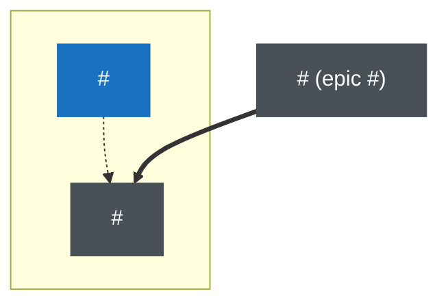

Title: `Epic: <leading word>: <goal>`

## Theme
**<Leading word>**: <one sentence that gives the goal. The leading word is a short word the team already uses. It names the one quality that every issue of this epic makes better.>

## Exit criterion
<The condition that closes this epic. Make it observable and checkable by a command. Include: the cleanup story of this epic is done.>

## Epic order
1. #<epic> <leading word>
2. #<epic> <leading word> (hard dependency on #<previous epic>) ← this epic
3. ...

## Parallel work
- WIP limit: <maximum number of issues of this epic in progress at the same time>
- Conflict groups: <for each group, the issues that change the same files; none of them run at the same time>

## All issues

| Issue | Title | Type | Status |
|---|---|---|---|
| #<n> | <title> | story | 🟡 in progress (claimed by <implementer>) |
| #<n> | <title> | story | 🔵 ready |
| #<n> | <title> | story | ⚫ blocked by #<n> |

Status values: 🟢 closed (date) · 🟡 in progress (claimed by …) · 🔵 ready · ⚫ blocked by #n or reason · ⚪ waiting (capacity) · ⏸ on hold (reason, revisit date) · 🟣 in review (reviewer, round n) · 🔍 verifying (round n) · 🟠 done in part and kept open (reason)

## Suggested order (YYYY-MM-DD)

| # | Issue | Short name | Reason |
|---|---|---|---|
| 1 | #<n> | <short name> | <leading word>: <how this issue serves the theme> (rule that selected the epic: <hard dependency / theme / same change area / new theme / maintenance>) |

## Progress
<!-- progress-diagram:start -->

**Legend:** green = closed · orange = in progress · blue = ready · gray = blocked · dotted arrow = suggested order · thick arrow = hard dependency.

**Current status** (YYYY-MM-DD): <closed>/<total> closed, <in progress> in progress (claimed by …), <open> open. Next: #<n> <short name>.
<!-- progress-diagram:end -->

<!--
How to use:
- Keep an epic to about 16 issues. If a theme needs more, divide it at a dependency boundary into several epics.
- Do not use a sequence name ("batch 7", "queue 3") as a theme. A sequence name has no exit criterion.
- After the first issue starts, keep the structure stable. Change only statuses, the ✅ marks, node states, the parallel-work section, and the status paragraph. Append new issues at the end of the table and the diagram. To change the order, add a new order table below the old one, with the date and the reason.
- Use dotted arrows for the suggested order and thick arrows for hard dependencies. The order table must agree with the dotted arrows. The thick arrows must agree with the dependency links.
- Show an issue of another epic that this epic depends on as a node outside all groups. Add the number of its epic to the label.
-->
