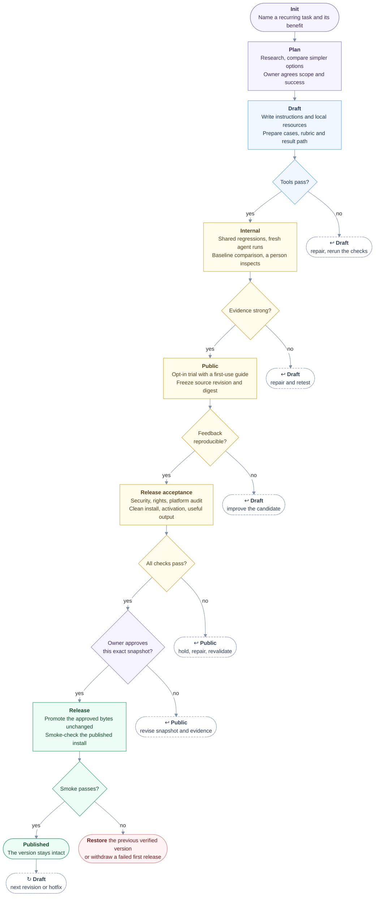

# Skill lifecycle: from useful idea to maintained release

A portable operating standard for building, evaluating, publishing and maintaining agent skills. Use it for one skill or a repository of skills. Publication can use a Git repository, registry, archive or client-specific catalog; no platform is required by the core process.

## Use the standard

1. Copy this whole folder into the receiving project.
2. Read [the SOP](./sop.md). Assign a human owner and select supported clients and publication targets.
3. Fill the project profile in [records](./records.md). Map tool roles using [the reference stack](./reference-stack.md).
4. Copy [the checklist](./checklist.yaml) for each candidate version. Validate it with [its JSON Schema](./checklist.schema.json) and reject duplicate item IDs in the validator wrapper.
5. Link the adopted standard and local profile from the project's agent instructions. Keep tasks in the tracker and evidence in versioned records.

The [skills.sh adapter](./adapters/skills-sh.md) is an optional example, not a dependency. Replace it when the publication target changes. Preserve the core evidence and approval requirements.

## The lifecycle at a glance

Read from the top down. Each diamond is a decision: "yes" moves on, and "no" follows a dashed pill to the stage where the work goes back. Purple is decided by a person, blue by tools, amber by evidence that a person reads, and green is the published release.

**Tools check correctness. Agents produce evidence. The owner decides what ships.** The dashed pills name return and recovery actions, not extra lifecycle stages. Missing required evidence blocks progress. Changed content reopens affected checks; an audit or approval for different bytes does not carry over.

These are required controls, not a claim that every gate is automated; each project's harness decides what it automates. Entering `internal` means evaluation is runnable; entering `public` means a candidate can be tried, not that it has passed release acceptance.

After release, improvements leave the published version intact and restart at Draft. A hotfix starts from its recorded source, passes the same applicable gates and is forward-ported to ongoing work. Failed delivery restores the previous verified package or withdraws a failed first release; state recovery is separate where relevant. Only the owner changes an accepted baseline.

## Scope and limits

This is a proposed reusable standard adopted for its originating project's process on 2026-11-06 by the owner. It is not an industry certification. End-to-end publication, recovery and use in a second repository remain unverified. A receiving owner must approve its local profile; copying files does not implement gates.

The schema checks record structure, not evidence truth, security or skill effectiveness. Tool implementations and their actual enforcement belong to each project's harness. Keep this folder self-contained; runtime skill packages must not require it.

## Evidence and revision

The SOP synthesizes [Agent Skills evaluation guidance](https://agentskills.io/skill-creation/evaluating-skills), [description evaluation](https://agentskills.io/skill-creation/optimizing-descriptions), [Anthropic's eval guidance](https://www.anthropic.com/research/demystifying-evals-for-ai-agents), [Microsoft's skill security guidance](https://learn.microsoft.com/en-us/agent-framework/agents/skills), [Git maintenance workflows](https://git-scm.com/docs/gitworkflows) and [SemVer](https://semver.org/). These sources inform the standard; none mandates this complete workflow.

Revision: 2026-11-06, initial portable SOP, evidence checklist and replaceable tool/platform profiles. Local research and implementation status stay in the adopting project, not in this portable folder.
