# Skill lifecycle: from useful idea to maintained release

A portable operating standard for building, evaluating, publishing and maintaining agent skills. Use it for one skill or a repository of skills. Publication can use a Git repository, registry, archive or client-specific catalog; no platform is required by the core process.

## Use the standard

1. Copy this whole folder into the receiving project.
2. Read [the SOP](./sop.md). Assign a human owner and select supported clients and publication targets.
3. Fill the project profile in [records](./records.md). Map tool roles using [the reference stack](./reference-stack.md).
4. Copy [the checklist](./checklist.yaml) for each candidate version. Validate it with [its JSON Schema](./checklist.schema.json) and reject duplicate item IDs in the validator wrapper.
5. Link the adopted standard and local profile from the project's agent instructions. Keep tasks in the tracker and evidence in versioned records.

The [skills.sh adapter](./adapters/skills-sh.md) is an optional example, not a dependency. Replace it when the publication target changes. Preserve the core evidence and approval requirements.

## The lifecycle at a glance

```mermaid
%%{init: {"theme": "base", "flowchart": {"curve": "basis", "nodeSpacing": 28, "rankSpacing": 36}, "themeVariables": {"fontFamily": "Arial, sans-serif", "fontSize": "15px", "lineColor": "#8292A5"}}}%%
flowchart LR
    init["<b>init</b>"] --> plan["<b>plan</b>"] --> draft["<b>draft</b>"] --> internal["<b>internal</b>"] --> public["<b>public</b>"] --> accept["<b>acceptance</b>"] --> approve["<b>owner<br/>approval</b>"] --> release["<b>release</b>"]

    classDef person fill:#F5F3FF,stroke:#8B7BC0,color:#3F2D66
    classDef tool fill:#EFF6FF,stroke:#60A5FA,color:#1E3A5F
    classDef evidence fill:#FFFBEB,stroke:#D6A93C,color:#59451D
    classDef done fill:#ECFDF5,stroke:#34A56F,color:#14532D
    class init,plan,approve person
    class draft tool
    class internal,public,accept evidence
    class release done
```

Colour shows who decides: purple a person, blue tools, amber evidence that a person reads, green the published release. Each step needs its evidence before the next:

| Step           | To advance                                                                                              | Decided by            | If it fails                                                      |
| -------------- | ------------------------------------------------------------------------------------------------------- | --------------------- | ---------------------------------------------------------------- |
| `init`         | The user, task and expected benefit are named, and a simpler alternative is compared                    | The owner             | Drop the idea or keep it recorded                                |
| `plan`         | The owner agrees scope, non-goals, observable success, capabilities and risks                           | The owner             | Keep researching                                                 |
| `draft`        | Format, links, lint, resources and secret checks pass; runnable cases, a rubric and a result path exist | Tools                 | Stay in `draft`; repair and rerun the checks                     |
| `internal`     | Shared regressions and a baseline comparison are run, and a person inspects the outputs                 | Evidence and a person | Weak or inconclusive evidence returns to `draft`                 |
| `public`       | A trial install works with a first-use guide; feedback is reproducible and tied to a version            | Evidence              | Feedback returns to `draft`                                      |
| acceptance     | Security, rights, platform audit, clean install, activation and useful output are checked               | Evidence              | A failed or missing check holds at `public` until repaired       |
| owner approval | The owner approves this exact snapshot, its targets and its known limits                                | The owner             | Declined: return to `public` and revise the snapshot             |
| `release`      | The approved bytes are promoted unchanged and a smoke check passes after publication                    | Tools and the owner   | Failed smoke: restore the previous verified artifact or withdraw |

**Tools check correctness. Agents produce evidence. The owner decides what ships.** Missing required evidence blocks progress. Changed content reopens the affected checks; an audit or approval for different bytes does not carry over. These are required controls, not a claim that every gate is automated; each project's harness decides what it automates.

After release, an improvement leaves the published version intact and starts again at `draft`. A hotfix starts from its recorded source, passes the same applicable gates and is forward-ported to ongoing work. Only the owner changes an accepted baseline.

## Scope and limits

This is a proposed reusable standard adopted for its originating project's process on 2026-11-06 by the owner. It is not an industry certification. End-to-end publication, recovery and use in a second repository remain unverified. A receiving owner must approve its local profile; copying files does not implement gates.

The schema checks record structure, not evidence truth, security or skill effectiveness. Tool implementations and their actual enforcement belong to each project's harness. Keep this folder self-contained; runtime skill packages must not require it.

## Evidence and revision

The SOP synthesizes [Agent Skills evaluation guidance](https://agentskills.io/skill-creation/evaluating-skills), [description evaluation](https://agentskills.io/skill-creation/optimizing-descriptions), [Anthropic's eval guidance](https://www.anthropic.com/research/demystifying-evals-for-ai-agents), [Microsoft's skill security guidance](https://learn.microsoft.com/en-us/agent-framework/agents/skills), [Git maintenance workflows](https://git-scm.com/docs/gitworkflows) and [SemVer](https://semver.org/). These sources inform the standard; none mandates this complete workflow.

Revision: 2026-11-06, initial portable SOP, evidence checklist and replaceable tool/platform profiles. Local research and implementation status stay in the adopting project, not in this portable folder.
